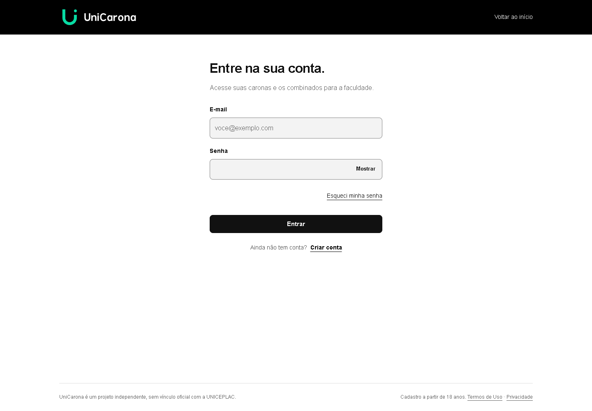
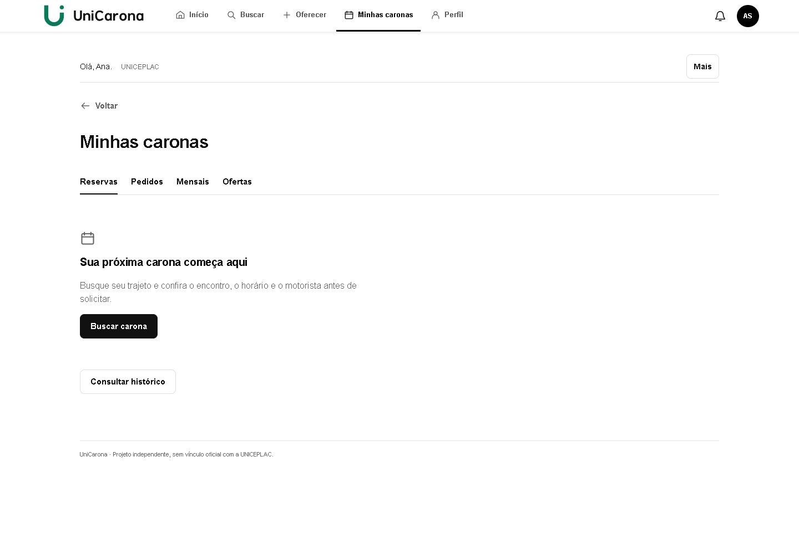
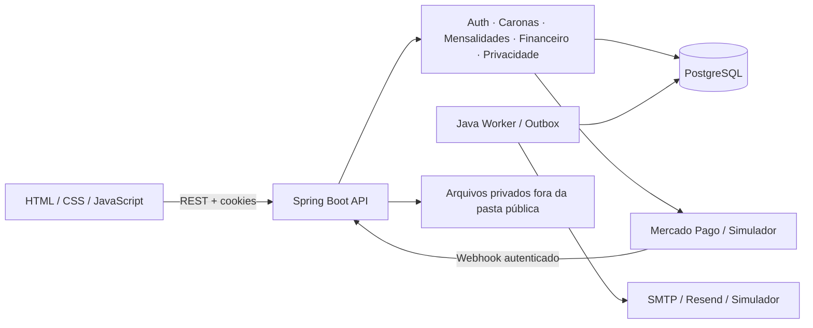

# UniCarona

Caronas universitárias com busca por trajeto, reservas avulsas e rotinas mensais.

  

Projeto independente de portfólio, desenvolvido por [Diego Fagundes](https://github.com/Diego-Fagundes888). Organiza o deslocamento entre estudantes e motoristas da mesma comunidade acadêmica, com disponibilidade de vagas, acompanhamento das reservas e regras financeiras explícitas. Não possui vínculo oficial com a UNICEPLAC.


[Executar a demonstração](#demonstração-local) · [Arquitetura](#arquitetura) · [Testes](#testes) · [Documentação](docs/README.md)

## Funcionalidades

| Área | Implementação atual |
|---|---|
| Acesso | Cadastro em etapas, confirmação de e-mail, login, recuperação de senha e renovação de sessão |
| Perfil | Dados acadêmicos declarados pelo estudante, região e edição do perfil |
| Caronas | Busca por região/data, oferta, solicitações, reservas e controle de vagas |
| Mensalidades | Rotinas, compatibilidade de horários, agenda, renovação e carência |
| Financeiro | Checkout, webhooks, conciliação, reembolso, carteira e ledger transacional |
| Comunidade | Notificações, bloqueios, ocorrências e análise administrativa |
| Privacidade | Documentos versionados, aceites, exportação, solicitações e encerramento de conta |
| Interface | Layout responsivo, navegação por teclado e mapa com atribuição OpenStreetMap |

**Em desenvolvimento.** O provedor de demonstração simula pagamentos e e-mails. A integração Mercado Pago possui implementação e testes, mas a aprovação comercial do marketplace e os repasses reais continuam pendentes. O vínculo acadêmico é autodeclarado. O catálogo jurídico versionado permanece em rascunho: disponibilizar o código não habilita uma operação comercial.

## Interface

Capturas da aplicação conectada ao Java, usando exclusivamente dados fictícios de demonstração.

| Acesso | Minhas caronas |
|---|---|
|  |  |

As imagens são estáticas para manter o README leve. A demonstração local permite explorar o produto.

## Tecnologias

- **Backend:** Java 21, Spring Boot 3.5, Spring Security, Bean Validation, JPA/Hibernate e JDBC.
- **Persistência:** PostgreSQL 18 e Flyway, com 47 migrations versionadas.
- **Frontend:** HTML, CSS e JavaScript modular, sem bundler; Leaflet para o mapa.
- **Integrações:** Mercado Pago Orders, SMTP/Resend e provedores locais de desenvolvimento.
- **Testes:** JUnit 5, Testcontainers, PostgreSQL real, Node Test Runner e Playwright.
- **Empacotamento:** Maven, JAR executável e Docker Compose.

O backend de aplicação é Java. TypeScript existe somente nas ferramentas de testes de navegador. Node.js não é necessário para executar o JAR de produção.

## Arquitetura

Monólito modular organizado por domínio. Controllers validam contratos HTTP; serviços coordenam regras e transações; repositories acessam PostgreSQL. O frontend é servido pela própria aplicação e chama `/api/v1` na mesma origem. Um processo separado executa manutenção e entrega da outbox.



Sessões usam cookies HttpOnly, rotação e revogação. Comandos autenticados validam origem e CSRF. Operações financeiras usam idempotência e registros contábeis; o banco mantém constraints e bloqueios transacionais. Há validação de entrada, hash Argon2id e limitação de requisições. Esses mecanismos não substituem revisão de segurança e preparação operacional.

```text
unicarona/
├── backend-java/
│   ├── src/main/java/com/unicarona/  # Módulos de domínio e infraestrutura
│   ├── src/main/resources/          # Configuração, migrations e documentos
│   ├── src/test/                    # Unitários, integração e fixtures fictícias
│   ├── e2e/                         # Jornadas de navegador contra Java real
│   └── scripts/                     # Ferramentas de desenvolvimento/operação
├── dist/                            # Fontes do frontend, incluídas no JAR
├── scripts/                         # Lint, assets e demonstração local
├── tests/                           # Contratos do cliente e referências históricas
├── config/                          # Exemplos de variáveis, sem valores
├── docs/                            # Arquitetura, API, decisões e imagens
└── compose.yaml                     # API, worker e PostgreSQL
```

`dist/` contém fontes necessárias ao produto; não é um build descartável.

## Demonstração local

### Pré-requisitos

- JDK 21 e Maven 3.9 ou superior no `PATH`.
- Node.js 24 a 26 e npm.
- Binários PostgreSQL 18, incluindo `initdb`, `pg_ctl`, `createdb` e `psql`.
- PowerShell 7 para os atalhos `npm run build`, `test:java` e `test:e2e`. O comando `demo` usa Node diretamente.

```sh
git clone https://github.com/Diego-Fagundes888/unicarona.git
cd unicarona
npm ci
mvn -f backend-java/pom.xml -DskipTests package dependency:build-classpath "-Dmdep.includeScope=test" "-Dmdep.outputFile=target/e2e-classpath.txt"
```

Informe a pasta `bin` do PostgreSQL instalado. Exemplo no PowerShell:

```powershell
$env:PG_BIN = 'C:/Program Files/PostgreSQL/18/bin'
npm run demo
```

No Linux/macOS, defina `PG_BIN` para a pasta equivalente antes de executar o mesmo comando. Não execute `initdb` como root. O caminho de instalação varia por máquina; nenhuma instalação automática de banco é feita.

O terminal informa a URL em loopback. Entre com **ana@example.com** e a senha **Synthetic seed test only 2026**. São credenciais públicas exclusivas de fixtures descartáveis. Há também contas fictícias de motorista e administração no seed.

A demonstração cria seu próprio cluster e uma senha aleatória de banco, aplica migrations e carrega seeds. Ela não recebe uma URL de banco existente. Cada execução começa com dados novos; `Ctrl+C` encerra o Java e o cluster criado. Artefatos locais ficam em `.local/`, ignorado pelo Git. Na instalação privada original, os helpers preservam a separação do armazenamento protegido.

Este comando usa o **classpath de testes** para publicar documentos sintéticos e preparar aceites das contas fictícias. Seus controles não entram no JAR de produção. Nunca exponha essa demonstração na internet. Sem `PG_BIN`, o harness tenta criar um container PostgreSQL via Docker; essa alternativa depende de um daemon acessível.

Verificação rápida, sem manter o servidor aberto:

```sh
npm run demo -- --check
```

### Execução normal e configuração própria

Para desenvolver sem o harness, configure `.env` a partir de [`.env.example`](.env.example). Os exemplos contêm somente nomes e comentários; defina os valores necessários localmente e remova as linhas das opções não utilizadas. Um valor vazio não equivale à ausência de uma variável. Use banco vazio de desenvolvimento e credenciais novas, sem reutilizar as fixtures públicas.

```sh
npm run build
npm run db:migrate
npm run db:seed
npm start
```

O JAR serve API e frontend juntos; não há servidor frontend separado. `npm run worker` inicia o worker. O seed exige `SEED_PASSWORD` com pelo menos 16 caracteres e é proibido em produção. Ele cria apenas contas e cenários fictícios. Para usar o fluxo completo de cadastro fora dos testes, é necessária a revisão e publicação explícita do catálogo jurídico; veja [execução e limites](docs/EXECUCAO.md).

| Variável | Finalidade | Quando necessária |
|---|---|---|
| `DATABASE_URL` | Conexão PostgreSQL com credenciais locais | API, migrations e worker |
| `TOKEN_PEPPER` | Proteção de tokens persistidos | Sempre |
| `PIN_ENCRYPTION_KEY` | Chave de 32 bytes em hexadecimal para PIN | Sempre |
| `JWT_SECRET` | Assinatura dos tokens de sessão | Sempre |
| `APP_ORIGIN` | Origem pública usada em links, cookies e validações | Sempre |
| `PAYMENT_WEBHOOK_SECRET` | Autenticação do simulador de pagamentos | Provedor development |
| `SEED_PASSWORD` | Senha local das contas fictícias | Seed |
| `PAYMENT_PROVIDER` / `EMAIL_PROVIDER` | Seleção dos provedores | Conforme ambiente |
| `MERCADO_PAGO_ACCESS_TOKEN` / `MERCADO_PAGO_PUBLIC_KEY` / `MERCADO_PAGO_WEBHOOK_SECRET` | Integração de pagamentos | Somente Mercado Pago |
| `SMTP_HOST` / `SMTP_USER` / `SMTP_PASS` | Entrega SMTP | Somente SMTP |
| `EMAIL_PROVIDER_API_KEY` | Entrega via Resend | Somente Resend |
| `STORAGE_PATH` | Armazenamento privado de anexos | Execução própria |
| `LEGAL_*` | Identificação pública e contexto dos documentos | Publicação jurídica |

Variáveis opcionais de retenção, infraestrutura e provedores estão em [config/](config/) e nos exemplos do backend. Nunca versione `.env`, uploads, dumps ou caixas de e-mail.

## API

Com a aplicação aberta, consulte `/api/docs` para Swagger UI e `/api/docs/json` para OpenAPI. Os endpoints de administração continuam exigindo permissão; documentação não concede acesso.

| Método | Endpoint | Uso |
|---|---|---|
| POST | `/api/v1/auth/register` | Cadastro e envio de confirmação |
| POST | `/api/v1/auth/login` | Login com cookies de sessão |
| POST | `/api/v1/auth/verify-email` | Confirmação com token de uso único |
| POST | `/api/v1/auth/forgot-password` | Solicitação de recuperação |
| GET | `/api/v1/rides` | Busca de caronas |
| GET | `/api/v1/reservations` | Reservas do participante autenticado |
| GET | `/api/v1/legal/documents` | Manifesto dos documentos publicados |

Use a especificação gerada pela instância para os schemas atuais, permissões, paginação e cabeçalhos de origem, CSRF e idempotência. Não coloque tokens de sessão em URLs ou exemplos compartilhados.

## Testes

```sh
npm run lint
npm run test:client
npm run test:tooling
mvn -f backend-java/pom.xml test
```

A suíte de integração inclui autenticação, permissões, concorrência, contratos REST, reservas, mensalidades, ledger, privacidade e migrations. Ela usa PostgreSQL real e não é substituída por mocks em memória.

```sh
npm run test:java
npm run test:e2e
```

A execução completa requer Docker para Testcontainers e ferramentas nativas PostgreSQL 18 em `TEST_PG_TOOLS_PATH` para os ensaios de backup/PITR. A alternativa local explícita exige um banco descartável chamado `unicarona_java_test`; seu schema é apagado pelos testes. Não aponte para dados que deseja preservar. Veja [testes e evidências](docs/QUALIDADE.md) e [harness](tests/README.md).

O CI executa lint, contratos do cliente, testes das ferramentas, unitários Java e empacotamento. Integração completa e navegador têm requisitos adicionais e são relatados separadamente; não há percentual de cobertura declarado.

## Status e próximos passos

- [x] Backend Java como única aplicação, frontend conectado e migrations preservadas.
- [x] Reservas, mensalidades, financeiro e privacidade com testes automatizados.
- [ ] Concluir preparação comercial, revisão jurídica e homologação dos repasses.
- [ ] Validar implantação e operação contínua em ambiente hospedado.
- [ ] Ampliar execução de integração e navegador no CI.

## Segurança, autoria e licença

Orientações para relato responsável estão em [SECURITY.md](SECURITY.md). A preparação pública inclui revisão dos arquivos e do histórico; credenciais reais, armazenamento privado e relatórios locais não fazem parte deste repositório.

**Autor:** [Diego Fagundes — GitHub](https://github.com/Diego-Fagundes888).

O projeto permanece **sem licença própria**, por decisão do autor. Não há concessão de reutilização por uma licença MIT/Apache. Dependências e assets de terceiros mantêm seus próprios avisos; consulte [ASSETS.md](ASSETS.md) e a [licença do Leaflet](dist/vendor/leaflet/LICENSE).
