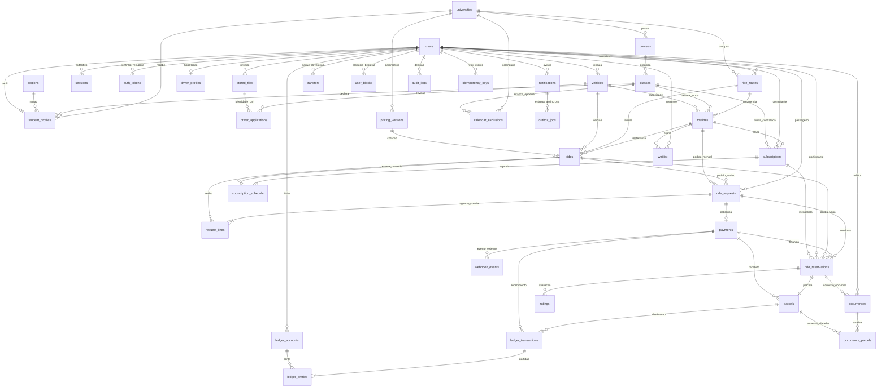

# Banco e modelo ER

PostgreSQL, UUIDs gerados pelo banco, FKs e timestamps. Estados usam `text` com
CHECK, para permitir migrations de novas transições sem recriar tipos enum.
Migrations são a definição física autoritativa; este diagrama mostra relações
e finalidade, sem repetir todos os campos de auditoria.

As duas últimas relações representam referências lógicas por payload/evento;
não são FKs do banco. Outbox inclui também envio de e-mail de autenticação.
`rate_limits` guarda somente buckets HMAC e expiração, sem e-mail/IP em claro.

## Unidades e invariantes

- Dinheiro em centavos (`integer` por operação, `bigint` nas partidas); taxas
  em pontos-base. Saldo vem da soma das partidas, não de campo editável.
- Distância em metros; consumo numérico em km/l. Preço usa aritmética racional
  inteira, sem arredondamentos de ponto flutuante em movimentos financeiros.
- Datas/horários das viagens são locais ao campus; instantes são `timestamptz`.
- Curso/universidade/turma usam FKs compostas para impedir combinação inválida.
- Exclusões de calendário têm alcance por faculdade ou turma, unicidade somente
  entre registros ativos e desativação com histórico. Versões de preço são imutáveis.
- Reserva ativa é única por passageiro e trecho. Pedido avulso ativo também.
- Capacidade é protegida por lock de trecho no serviço e trigger no banco.
  Agenda mensal é uma única transação; carência é hold explícito por trecho.
- Parcelas liberadas somam líquido + comissão = pago. Partidas de cada
  transação somam zero no COMMIT; histórico financeiro e auditoria são imutáveis.
- PIN é aleatório, cifrado para apresentação somente ao passageiro e com hash
  para conferência. Credenciais e tokens não aparecem nos DTOs.
- Documentos têm proprietário, finalidade, tipo validado, tamanho, hash e chave
  de armazenamento privada. A fotografia não comprova autenticidade documental.
- Reservas e parcelas têm transições protegidas por triggers. Valores e vínculos
  contratados são imutáveis; parcelas liquidadas não retornam a estados anteriores.
  Um trigger diferido exige a reserva paga e o lançamento correspondente à
  destinação financeira. Crédito, líquido, comissão e retenção devem coincidir
  com o ledger no COMMIT. Esses controles não substituem autorização dos serviços.
- Soft delete em usuário/veículo/arquivo conserva vínculos necessários ao
  histórico. Remoção física/anonimização deve obedecer política de retenção,
  sem destruir ledger ou decisões administrativas.

Índices cobrem busca por universidade/data/sentido/horário, região por trigram,
pedidos por participante/status, disponibilidade por trecho, contratos ativos,
parcelas por titular/status, avisos recentes, outbox e saldo de contas.
Não se exige PostGIS, Redis nem múltiplos bancos no estágio inicial.

## Máquinas de estado

- **Pedido:** pending → accepted/rejected/expired/cancelled;
  accepted → confirmed/expired/cancelled. Confirmed cria reservas, não é execução.
- **Viagem:** planned → active → completed; planned/active → cancelled;
  planned → no_class. O banco rejeita retorno de completed para planned.
- **Reserva:** confirmed → boarded → awaiting_confirmation → completed;
  confirmed → cancelled; situação contestada → under_review, com decisão separada.
- **Pagamento:** awaiting → pending → approved ou failed/expired;
  recebimento autenticado sem agenda/capacidade válida permanece approved,
  sem reserva e com crédito integral do valor externo efetivamente recebido.
  Devolução externa é uma transferência separada; não se afirma estorno realizado.
- **Parcela:** future → awaiting → released/retained; future/awaiting → blocked;
  blocked → released/credited/retained por apuração; crédito por cancelamento.
- **Mensal:** active → grace/renew_conflict → renewed/expired;
  active → cancelled_renewal → ended; encerramento acadêmico → ended;
  segurança → interrupted. Encerramento não desfaz trechos consumidos.
- **Ocorrência:** pending → financial_pending/resolved, preservando a separação
  entre proteção de acesso e resolução financeira.
- **Job:** pending → processing → done; falha → pending com backoff; limite → dead.
- **Transferência:** pending → approved/failed, sem alterar duas vezes o saldo.

Estados financeiros não substituem estados da reserva; embarque não liquida.

A migration 013 impede reabertura e modificação do recebimento do pagamento,
troca de identidade/valor de pagamento ou transferência e alteração de checkout
já atribuído pelo provedor. Triggers diferidos conferem o objeto final com os
journals de recebimento, saldo separado e resultado da transferência. Pagamento
recebido após expirar ou falhar pode ser reconhecido e creditado, sem reabrir o
pedido ou ocupar vaga indevidamente. Pagamentos e transferências não são apagados.
