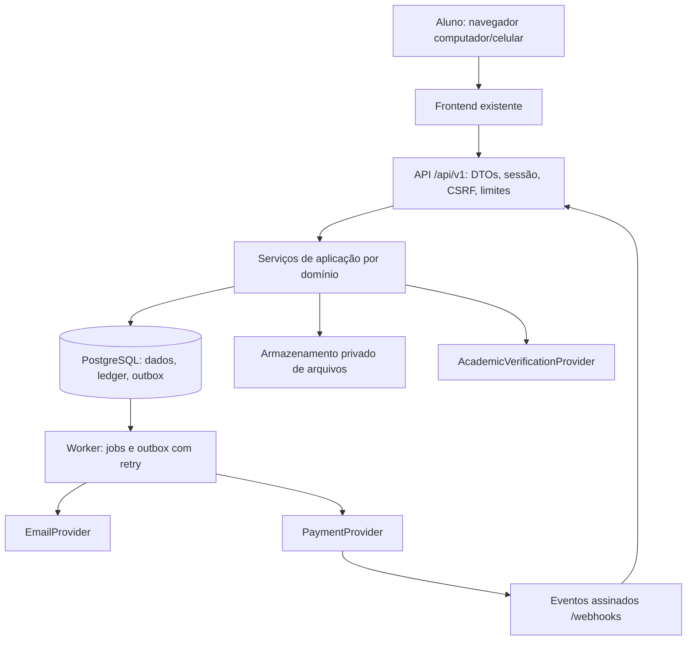

# System Design do UniCarona

O backend atual é um monólito modular em Java 21/Spring Boot, com PostgreSQL,
JDBC/JPA, Flyway, Spring Security e frontend HTML/CSS/JS na mesma origem.
O backend TypeScript foi retirado; veja
[Retirada_Backend_TypeScript.md](Retirada_Backend_TypeScript.md).

## Decisão inicial (histórica)

Monólito modular em Node.js 24 LTS, TypeScript e Fastify; PostgreSQL 18,
SQL parametrizado com `pg`, migrations versionadas e transações explícitas.
O frontend HTML/CSS/JS atual é preservado e servido na mesma origem da API.
Não se introduzem React, microsserviços, Kafka, Kubernetes ou event sourcing.

## Módulos e propriedade dos dados

- **auth**: credenciais, sessões, rotação/expiração, verificação e recuperação.
- **identity**: usuário e perfil de estudante; universidades/cursos/turmas,
  preferências e adapter de verificação acadêmica.
- **drivers**: habilitação administrativa, documentos privados e veículos.
- **rides**: percurso, rotina, trecho concreto, disponibilidade e pesquisa.
- **reservations**: solicitação, aceite, reserva/PIN, execução e confirmação.
- **subscriptions**: contrato mensal, agenda, elegibilidade, carência e renovação.
- **billing**: pagamento, parcelas, provider, webhooks, ledger e transferências.
- **safety**: ocorrências, bloqueios, interrupção e análise independente do dinheiro.
- **notifications**: avisos no app e outbox para e-mail/push futuro.
- **admin**: versões de parâmetros, calendário e revisão preventiva de acesso;
  decisões com autorização específica e trilha de auditoria. A apuração financeira
  pertence a safety/billing e permanece separada da suspensão de uma conta.
- **ratings**: avaliação vinculada a participação concluída. Requisito novo do
  objetivo; não é assinatura de acesso ao aplicativo. Liberar a interface
  somente quando a política de avaliação for definida.

Serviços compartilham uma unidade de trabalho SQL na mesma transação. Módulos
não executam HTTP entre si. Eventos persistidos no outbox permitem separar
entrega de avisos e processamento externo futuramente, sem perder eventos.

## Consistência e dinheiro

Capacidade pertence a cada trecho. Travar trechos em ordem de ID antes de
confirmar todas as vagas de uma contratação; a transação inteira falha se
qualquer trecho estiver sem vaga. Uma constraint/trigger no banco serve como
segunda barreira contra overbooking, inclusive com acesso SQL direto.
Reservas não são serializadas por um lock global da universidade. Cotações e
confirmações mensais usam locks compartilhados compatíveis da faculdade apenas
para coordenar alterações exclusivas do calendário. Não salvar o sistema num JSON.

Pedidos sem pagamento não reservam vagas, exceto a carência expressamente
modelada. Um pagamento pode chegar depois da última vaga ser ocupada: o evento
fica registrado e o valor recebido é encaminhado a crédito/devolução, sem
overbooking ou dinheiro perdido. A confirmação externa não pode ser descartada
como se nenhuma cobrança tivesse ocorrido.

Valores em centavos e taxas em pontos-base. Preço/agenda/parâmetros congelados
na contratação. Diário financeiro de partidas equilibradas e imutáveis,
chave única por evento e contas separadas para futuro, bloqueado, disponível,
crédito, comissão, retenção, transferências e compensação do provedor.

## Segurança e privacidade

Hash de senha Argon2id; tokens aleatórios com hash no banco. Cookies HttpOnly,
Secure em produção, SameSite e validação CSRF/origem nas mutações do navegador.
Refresh com rotação e detecção de reutilização. Tokens de email/senha expiram
e têm uso único. Respostas genéricas para login/recuperação e limites persistentes
de tentativas. Identidade vem da sessão, nunca de `userId` enviado pelo cliente.

Autorização por proprietário/participação e papel de admin em cada operação.
Restrição da conta não remove acesso ao relato de segurança. DTOs não incluem
hashes, tokens, documentos, telefone ou PIN de terceiros. Placa completa e
contato só após reserva para participantes. Nenhum diretório de rotinas pessoais.
Arquivos privados com allowlist, limite, inspeção do conteúdo e download
autorizado; o armazenamento local pode ser trocado por S3 compatível.

Não declarar conformidade jurídica ou vínculo institucional. Dados acadêmicos
autodeclarados recebem esse status; verificação institucional é um adapter
separado. Universidade é uma FK, não uma constante espalhada no domínio.

## Jobs, cache e falhas

Worker independente usando PostgreSQL `FOR UPDATE SKIP LOCKED`, leases,
backoff limitado e dead-letter. Faz entrega, expiração e liquidação após
janela documentada. Jobs reexecutáveis e idempotentes. Requisições não aguardam
envio de e-mail ou saque. Provedor indisponível deixa operação pendente;
timeout não significa falha financeira definitiva.

Checkout e envio de transferências têm prazo configurável
(`PAYMENT_PROVIDER_TIMEOUT_MS`, padrão 10 s), com sinal de cancelamento para o
adapter. Retentativas usam o mesmo ID financeiro no provedor. A API normaliza
indisponibilidade de banco/pool e timeouts para 503, sem SQL ou diagnósticos
privados. A desconexão de um cliente ocioso do pool é registrada sem derrubar o
processo. A conclusão de um job confere ID, estado e número da tentativa; um
callback de lease antigo não substitui o estado de um novo worker.

Sem Redis no estágio 1. Rate limits e filas duráveis no PostgreSQL; catálogos
podem usar cache HTTP por versão. Pool limitado, queries paginadas, índices
por filtros reais, busca sem N+1. Health não depende do banco; readiness confere
conexão, todas as versões esperadas de migration e seus checksums. Uma tabela
alcançável com migration ausente ou alterada não é considerada pronta.
Logs JSON com request ID e redação de segredos/PII; métricas agregadas sem
identificadores de alunos. Alertar falha de outbox e divergência de ledger.

## Três estágios

| Estágio | Arquitetura e gatilhos de evolução |
|---|---|
| UNICEPLAC / milhares | API + worker + PostgreSQL + armazenamento; mesma origem |
| Regional / dezenas de milhares | múltiplas instâncias sem estado; universidades isoladas por FK; armazenamento externo; medir necessidade de Redis e réplica de leitura |
| Nacional | particionar por região/universidade quando medição justificar; extrair notificações/financeiro pelas fronteiras existentes; PostGIS para busca espacial se necessário |

Coordenadas são opcionais e validadas, junto a endereço e ponto de encontro.
Não implementar GPS ao vivo ou medir uma distância sem fonte. PostgreSQL B-tree
atende busca inicial por região/data/sentido. PostGIS não é dependência inicial.

## Referências primárias

Princípios adaptados, sem copiar a infraestrutura das plataformas:
[Uber: pagamentos, idempotência e partidas dobradas](https://www.uber.com/en-HR/blog/payments-platform/),
[PostgreSQL: locking](https://www.postgresql.org/docs/18/explicit-locking.html),
[Fastify: contratos](https://fastify.dev/docs/latest/Reference/Validation-and-Serialization/),
[pg: transações](https://node-postgres.com/features/transactions),
[OWASP: senha](https://cheatsheetseries.owasp.org/cheatsheets/Password_Storage_Cheat_Sheet.html)
e [sessões](https://cheatsheetseries.owasp.org/cheatsheets/Session_Management_Cheat_Sheet.html).
